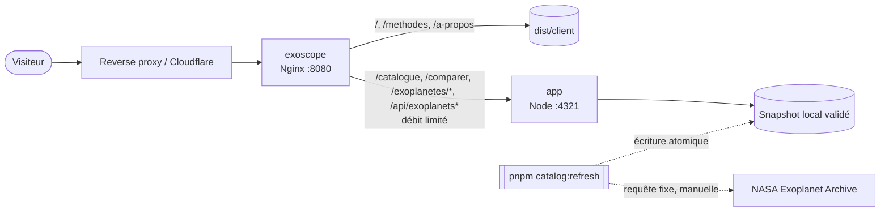

<div align="center">

# ExoScope

**Explorer les mondes au-delà du Système solaire.**
Un explorateur pédagogique d'exoplanètes, construit avec Astro et React, à partir du catalogue de la NASA
Exoplanet Archive.

[](https://astro.build)
[](https://react.dev)
[](https://www.typescriptlang.org)
[](https://ui.shadcn.com)
[](https://pnpm.io)
[](https://www.docker.com)
[](https://nginx.org)
[](LICENSE)

[Fonctionnalités](#fonctionnalités) · [Architecture](#architecture) · [Données](#données) · [Démarrage](#démarrage) · [Tests](#tests) · [Déploiement](#déploiement) · [Sécurité](#sécurité) · [Non-indexation](#non-indexation)

</div>

---

## Fonctionnalités

- **Accueil** : recherche immédiate, statistiques du snapshot, planètes emblématiques, distribution des
  découvertes, mondes de taille et de température comparables à la Terre (sans jamais les présenter comme
  habitables) et introduction aux méthodes de détection.
- **Catalogue** (`/catalogue`) : recherche différée avec annulation des requêtes obsolètes, filtres par nom,
  étoile hôte, méthode, année, distance, masse, rayon, période, température d'équilibre et nombre de planètes,
  curseurs logarithmiques accessibles, tri, pagination côté serveur, tableau sur ordinateur et cartes sur mobile,
  états de chargement, vide et d'erreur. L'état complet est reflété dans l'URL.
- **Fiche planète** (`/exoplanetes/[slug]`) : résumé rédigé uniquement à partir des données connues,
  caractéristiques groupées, densité calculée seulement quand la masse et le rayon sont mesurés, comparaison
  avec la Terre, Neptune et Jupiter, planètes du même système, mondes comparables et lien vers la source.
- **Comparateur** (`/comparer`) : jusqu'à quatre planètes côte à côte, valeurs extrêmes signalées par une
  icône et un texte, partage par l'URL, liste conservée dans le navigateur, nuages de points masse-rayon et
  période-demi-grand axe chargés à la demande.
- **Méthodes** (`/methodes`) : transit, vitesse radiale, imagerie directe, microlentille, astrométrie et
  variations du temps de transit, avec schémas SVG accessibles, forces, limites et exemples du catalogue.
- **À propos** (`/a-propos`) : objectif, source, date du snapshot, limites scientifiques et confidentialité.

Chaque valeur affichée indique sa provenance : mesurée, masse minimale (`M sin i`), estimée par l'archive via
une relation masse-rayon, calculée, ou limite publiée. Une donnée absente est affichée « Non renseigné ».

## Architecture

| Service    | Image                         | Rôle                                                                 |
|------------|-------------------------------|----------------------------------------------------------------------|
| `exoscope` | `nginx-unprivileged` (Alpine) | Sert les pages statiques précompressées et relaie les routes dynamiques |
| `app`      | `node` (Alpine)               | Serveur Astro autonome : catalogue, fiches, comparateur et API        |



Le site ne contacte jamais l'archive pendant une visite. Les pages statiques sont prérendues au build ; les
6 000 fiches et les vues filtrées sont rendues à la demande à partir du snapshot chargé en mémoire.

```text
src/
├── components/
│   ├── charts/          Graphiques SVG statiques et nuage de points Recharts
│   ├── exoplanets/      Composants du domaine (recherche, catalogue, fiche, comparateur)
│   ├── layout/          En-tête, pied de page, logo, thème, SEO
│   └── ui/              Composants shadcn/ui
├── data/                Métadonnées du site, contenu éditorial, accès au snapshot
│   └── generated/       Snapshot versionné du catalogue
├── domain/              Logique métier pure : modèle, unités, filtres, comparaison, graphiques
├── hooks/               Hooks React (recherche, résultats, liste de comparaison)
├── lib/                 Formatage, validation Zod, cache HTTP, URL, CSP
├── pages/               Routes et API
├── services/            Récupération et normalisation des données de l'archive
└── styles/              Tokens et styles globaux
scripts/                 Mise à jour du snapshot
tests/                   Tests unitaires, d'intégration et end-to-end
```

### API interne

Toutes les routes n'acceptent que `GET` et `HEAD`, valident leurs paramètres avec Zod, ignorent les paramètres
inconnus et renvoient un JSON minimal, sans détail interne en cas d'erreur.

| Route                            | Paramètres                                                                 | Limites                                    |
|----------------------------------|----------------------------------------------------------------------------|--------------------------------------------|
| `GET /api/exoplanets`            | `q`, `etoile`, `methode`, `<champ>-min`, `<champ>-max`, `mesurees`, `tri`, `ordre`, `page`, `taille` | page ≤ 1 000, taille ∈ {10, 25, 50}, tri en liste blanche, 32 paramètres et 2 048 caractères au plus |
| `GET /api/exoplanets/search`     | `q`, `limite`                                                              | 2 à 100 caractères, 20 résultats au plus   |
| `GET /api/exoplanets/compare`    | `planetes` (identifiants séparés par des virgules)                         | 4 planètes au plus                         |
| `GET /api/exoplanets/[slug]`     | identifiant de la planète                                                  | identifiant validé, 404 si inconnu         |

Champs filtrables : `annee`, `distance` (années-lumière), `masse` (masses terrestres), `rayon` (rayons
terrestres), `periode` (jours), `temperature` (kelvins), `planetes`.

## Données

La source est la table [PSCompPars](https://exoplanetarchive.ipac.caltech.edu/docs/pscp_about.html) de la
[NASA Exoplanet Archive](https://exoplanetarchive.ipac.caltech.edu) : une ligne par planète confirmée.

Le script [`scripts/refresh-exoplanet-catalog.ts`](scripts/refresh-exoplanet-catalog.ts) :

1. envoie une requête ADQL fixe, limitée aux colonnes de [`query.ts`](src/services/exoplanet-archive/query.ts),
   vers le seul hôte autorisé, sans redirection, avec un délai d'expiration et une taille de réponse maximale ;
2. valide chaque ligne avec Zod et rejette les lignes invalides ;
3. écarte les valeurs physiquement implausibles et déduit la provenance de chaque valeur (`pl_bmassprov`,
   colonnes `*_reflink` « Calculated Value », drapeaux de limite `*lim`) ;
4. calcule la constellation à partir des coordonnées (frontières de l'UAI) ;
5. valide le snapshot complet (schéma, identifiants uniques, taille), refuse un catalogue de moins de
   4 000 planètes ou en baisse de plus de 10 % ;
6. remplace le fichier de manière atomique et affiche un rapport sans donnée brute.

En cas d'échec, le dernier snapshot valide est conservé. Le snapshot est versionné dans
[`src/data/generated`](src/data/generated) pour des builds reproductibles et hors ligne.

```bash
pnpm catalog:refresh
```

Une automatisation planifiée (tâche cron ou workflow CI qui lance ce script puis ouvre une pull request) pourra
être ajoutée plus tard ; elle n'est pas nécessaire tant que la mise à jour reste manuelle.

> This research has made use of the NASA Exoplanet Archive, which is operated by the California Institute of
> Technology, under contract with the National Aeronautics and Space Administration under the Exoplanet
> Exploration Program.

## Démarrage

### Prérequis

- [Node.js](https://nodejs.org) 22.23.4 ou plus récent
- [pnpm](https://pnpm.io) 12 (la version exacte est fixée dans `packageManager`)

```bash
git clone https://github.com/506f6c6c7578/ExoScope.git
cd ExoScope
pnpm install
pnpm dev
```

Le site est accessible sur <http://localhost:4321>. Aucune variable d'environnement n'est nécessaire.

### Scripts

| Commande               | Description                                              |
|------------------------|----------------------------------------------------------|
| `pnpm dev`             | Lance le serveur de développement                        |
| `pnpm check`           | Vérifie le typage et les diagnostics Astro               |
| `pnpm build`           | Vérifie le typage puis génère le site dans `dist/`       |
| `pnpm preview`         | Lance le serveur de production construit                 |
| `pnpm test`            | Lance les tests unitaires (Vitest)                       |
| `pnpm test:e2e`        | Lance les tests d'intégration et end-to-end (Playwright) |
| `pnpm catalog:refresh` | Met à jour le snapshot depuis la NASA Exoplanet Archive  |
| `pnpm audit`           | Audite les dépendances                                   |

## Tests

- **Unitaires** ([`tests/unit`](tests/unit)) : unités, slugs, densité, formatage, provenance, normalisation,
  validation du snapshot, filtres, pagination, tri, comparaison, échelles, archive indisponible, écriture
  atomique et conservation du dernier snapshot.
- **Intégration** ([`tests/integration`](tests/integration)) : endpoints, entrées invalides, limites,
  pagination, identifiants inconnus, cache, méthodes HTTP, en-têtes, CSP et non-indexation, contre le serveur
  de production.
- **End-to-end** ([`tests/e2e`](tests/e2e)) sur Chrome ordinateur et Pixel 7 : recherche, fiche, filtres,
  curseurs au clavier, tri, pagination, état vide, état d'erreur, comparateur, graphiques, thèmes, navigation
  au clavier, absence d'erreur console (dont les violations de CSP) et de débordement horizontal.

```bash
pnpm test
pnpm build && pnpm test:e2e
```

## Déploiement

ExoScope se déploie indépendamment du portfolio, avec son propre projet Compose (`exoscope`) :

```bash
docker compose up -d --build
```

Les services exposent leurs ports sur le réseau Compose sans les publier sur l'hôte. Place le reverse proxy
existant (ou le tunnel Cloudflare) sur le même réseau, redirige `exo.paulviandier.com` vers `exoscope:8080`,
puis crée l'enregistrement DNS et le certificat TLS du sous-domaine. Nginx lit l'adresse du pair transmise dans
`X-Forwarded-For` et ne se fie à `CF-Connecting-IP` que si ce pair appartient aux plages de Cloudflare.

## Sécurité

<details>
<summary><strong>Application</strong></summary>

- Content Security Policy à base d'empreintes générée par Astro, limitée à `self`, sans `unsafe-inline` ni
  pour les scripts ni pour les styles. Les composants qui injectent des styles à l'exécution ont été écartés
  ou ne sont montés qu'après hydratation.
- Validation Zod de tous les paramètres d'URL, des réponses de l'API côté client, du stockage local, des
  lignes de l'archive et du snapshot.
- Aucune entrée utilisateur n'est transmise à l'archive : la seule requête externe est fixe et lancée
  manuellement par le script.
- Tri par liste blanche, pagination et tailles bornées, nombre et longueur des paramètres limités.
- Taille maximale des requêtes (1 Kio) et liste d'hôtes autorisés côté serveur.
- Aucune donnée utilisateur conservée côté serveur, aucun cookie, aucun service tiers.

</details>

<details>
<summary><strong>Nginx</strong></summary>

- Seules les méthodes `GET` et `HEAD` sont acceptées.
- Limitation de débit par adresse IP sur les pages dynamiques et l'API, avec une réponse `429` structurée.
- Seules les routes d'API connues sont relayées ; tout autre chemin sous `/api/` renvoie `404`.
- En-têtes de sécurité sur chaque réponse : HSTS, `frame-ancestors 'none'`, `X-Content-Type-Options`,
  `X-Frame-Options`, `X-Robots-Tag`, `Referrer-Policy`, `Permissions-Policy` et `Cross-Origin-Opener-Policy`.
- Version du serveur masquée, fichiers cachés inaccessibles, cache immuable pour les ressources versionnées et
  fichiers gzip précompressés.

</details>

<details>
<summary><strong>Conteneurs</strong></summary>

- Images de base fixées par version et par empreinte SHA-256, lockfile obligatoire (`--frozen-lockfile`).
- Scripts d'installation des dépendances refusés par défaut (`allowBuilds` dans `pnpm-workspace.yaml`).
- Gestionnaires de paquets Node retirés de l'image d'exécution, contexte de build en liste blanche.
- Utilisateurs non root, fichiers applicatifs appartenant à `root`, système de fichiers en lecture seule,
  `tmpfs` pour `/tmp`, `cap_drop: ALL`, `no-new-privileges`, limites de CPU et de mémoire, health checks et
  journaux plafonnés.

</details>

Aucune configuration ne garantit l'absence totale de faille. Tu as trouvé une vulnérabilité ? Signale-la en
privé via le [formulaire de contact](https://paulviandier.com/contact) plutôt que d'ouvrir une issue publique.

## Non-indexation

Le sous-domaine demande à ne pas être indexé : balise `<meta name="robots" content="noindex, nofollow,
noarchive, nosnippet">` sur chaque page, en-tête `X-Robots-Tag` identique sur chaque réponse, aucun sitemap,
aucune URL canonique, aucun outil de suivi.

Aucun `robots.txt` ne bloque l'exploration : un robot doit pouvoir lire la directive `noindex` pour la
respecter. Ces mesures restent déclaratives : un site public ne peut pas être garanti introuvable. Pour le
rendre réellement privé, il faut ajouter une protection d'accès au niveau du reverse proxy ou de Cloudflare
(Cloudflare Access, authentification HTTP ou liste d'adresses autorisées).

## Licence

© 2026 Paul Viandier. Tous droits réservés. Consulte le fichier [`LICENSE`](LICENSE) pour le détail. Les
données astronomiques proviennent de la NASA Exoplanet Archive et restent soumises à ses conditions.
